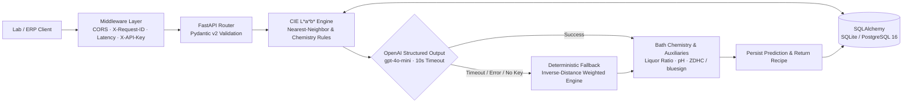

# Smart-Lab Predictive Color-Matching API

[](https://github.com/ankit5841/smart-lab-color-predictor/actions/workflows/ci.yml)


Production-hardened FastAPI microservice that predicts textile dye formulations and bath chemistry from CIE L\*a\*b\* color targets, pairing OpenAI Structured Outputs with a deterministic mathematical fallback so third-party LLM outages never fail production requests.

> **Portfolio Note:** Clean-room reference implementation built with synthetic formulation data to demonstrate production backend, resilience, and applied-ML architecture patterns for textile manufacturing domains. No proprietary company code or confidential data is included.

## Architecture



## Verified Engineering Highlights

| Capability | Implementation | Result / Guarantee |
| :--- | :--- | :--- |
| **Model Accuracy** | Leave-one-out ground-truth evaluation (`GET /api/v1/metrics/evaluate`) | **92.31%** concentration accuracy within tolerance; **39.77%** lab-trial reduction |
| **LLM Resilience** | OpenAI Structured Outputs (`gpt-4o-mini`, 10s timeout) with deterministic fallback | Zero request failures during upstream API timeouts or missing credentials |
| **Domain Chemistry** | Auto-maps synthetics (polyester, nylon, acetate) to **Disperse Dyes** (130°C, pH ~4.8) and cellulosics (cotton, linen, viscose) to **Reactive Dyes** (60°C, pH ~10.8) | Auxiliaries scale dynamically with GSM and liquor ratio; supports ZDHC Level 3 & bluesign filtering |
| **Production Controls** | FastAPI lifespan management, optional `X-API-Key` auth, `X-Request-ID`, `X-Process-Time-Ms`, structured logging | End-to-end request traceability and protected mutation/prediction paths |
| **CI/CD & Packaging** | Multi-container `docker-compose.yml` (FastAPI + PostgreSQL 16 healthcheck), `Jenkinsfile`, GitHub Actions CI | Automated 7-test `pytest` verification on every push |

## API Endpoints

| Method | Endpoint | Purpose |
| :--- | :--- | :--- |
| `GET` | `/health` | Service and database health probe |
| `POST` | `/api/v1/predict-recipe` | Predict dye concentrations, bath conditions, and auxiliaries |
| `POST` | `/api/v1/nearest-matches` | Retrieve closest historical CIE L\*a\*b\* formulations |
| `GET` | `/api/v1/predictions` | List persisted prediction history |
| `POST` | `/api/v1/predictions/{prediction_id}/feedback` | Record lab Delta-E and trial count feedback |
| `GET` | `/api/v1/metrics/evaluate` | Run live leave-one-out concentration MAE and trial-reduction evaluation |

## Engineering Trade-offs & Production Notes

* **Deterministic fallback over retries alone:** Retrying a slow LLM call compounds tail latency on lab terminals; falling back to inverse-distance CIE L\*a\*b\* interpolation bounds worst-case response time while keeping outputs physically valid.
* **Dual SQLite / PostgreSQL support:** Defaults to SQLite for zero-friction local review and switches seamlessly to PostgreSQL 16 via `DATABASE_URL` in Docker Compose.
* **Synthetic seed catalog:** Uses deterministic synthetic dye records to keep evaluation metrics reproducible across CI runs without exposing sensitive customer shade cards.

## Quick Start

```bash
# Local development
cp .env.example .env
pip install -r requirements.txt
python -m pytest -v
uvicorn app.main:app --reload --env-file .env
# Swagger UI: [http://127.0.0.1:8000/docs](http://127.0.0.1:8000/docs)

# Full stack (FastAPI + PostgreSQL 16)
docker compose up --build
```